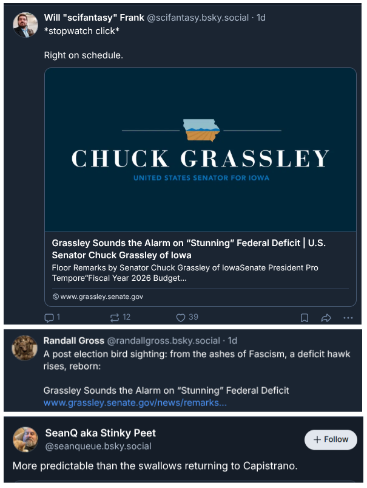

Politics, like some birds, follow migration patterns. As the electoral seasons turn, you can expect to see certain species that you haven't seen in a while. Before an election, 'border birds' fly through with their caws warning of migratory caravans. They move rather quickly and are often gone as soon as the election is over. 

The deficit hawk's migration pattern is less regular but just as predictable. They can disappear for years, but once democrats take power, they reappear and hunker down until Republicans retake control. Just weeks after the 2026 blue wave election, hawkish Senator Grassley (IA-R) has returned to warn of [the "stunning" federal debt](https://www.grassley.senate.gov/news/remarks/grassley-sounds-the-alarm-on-stunning-federal-deficit). Although Grassleys have perched in the Senate since 1981, you can identify a deficit-hawk Grassley by its distinctive song. The newly arrived hawkish Grassley gives a shrill scream about deficits, while the Grassley seen in 2001 [passed \$1.35 trillion in tax cuts](https://www.washingtonpost.com/archive/politics/2001/06/08/bush-signs-tax-bill-into-law/e22dc2b3-5c30-4800-bf83-b2f5126829ee/) and was spotted in 2025 [spearheading large portions of the $3.4 trillion Big Beautiful Bill Act](https://www.judiciary.senate.gov/press/rep/releases/the-one-big-beautiful-bill-makes-america-safe-again) with nary a fiscal peep.

Today I saw reports of a debt hawk singing right here in Madison! The Concord Coalition is giving a series of talks, noteworthy enough to get a front-page mention and a full op-ed by Cap Times President and Publisher Paul Fanlund titled "[Why the national debt should be a progressive priority](https://captimes.com/opinion/paul-fanlund/opinion-why-the-national-debt-should-be-a-progressive-priority/article_5e67d659-0dc1-4ee7-a85b-db7c10a6e999.html)."

But is this really a cynical deficit hawk? Concord Coalition's speaker and president, Carolyn Bourdeaux, is a former Democratic representative and will be flanked by two former Wisconsin congressmen, Rob Kind (D) and Reid Ribble (R). 

I do not know what is motivating Bourdeaux, Kind, or even Fanlund to draw attention to the deficit in this moment. Maybe they are truly concerned about the federal debt and believe their efforts are better spent targeting the left because they know the right doesn't actually care about such things. 

What I do know is that the the Concord Coalition's is supported by the 501(c)(3) Concord Coalition Corp, whose [largest donor by far](https://philanthropy.org/990/who-funds/521787869/the-concord-coalition-corp) is the Peter G Peterson Foundation, and by the Concord Coalition Action Fund, which received [a large grant](https://philanthropy.org/990/grants-by/882743235/peterson-solutions-fund) from the Peterson Solutions Fund. 

The Peterson Foundation was founded by Peter Peterson, a cabinet member under President Nixon. Peterson [has been criticized](https://en.wikipedia.org/wiki/The_Peter_G._Peterson_Foundation#Criticism) for using the foundation for his ultimate goal of gutting social security, medicare, and medicaid, while simultaneously [opposing deficit cutting measures](https://archive.nytimes.com/economix.blogs.nytimes.com/2010/06/17/pete-peterson-and-the-deficit/) that would affect him.

The Peterson Solution Fund is currently led by Executive Director Brett Loper, a former American Express executive and staffer to House Speakers Boehner (R) and DeLay (R). Loper reportedly had [a bit part in the Abramoff scandal](https://www.washingtonexaminer.com/magazine/1426270/the-friends-of-tom-delay/?srsltid=AYCX9vK4CKXTlOjrsGumkkcthH2l44Vkv0QRDII0UiYmfswlrXqRmDk7), accompanying another DeLay staffer to find pork opportunities on the Marianas islands to support Abramoff's favored politicians.

When the newly elected class joins the U.S. Congress in January, they will have many voter concerns to address: healthcare, gas prices, corruption, an economy hobbled by tariffs and war. And yet, here is the Concord Coalition, abetted by Capital Times, calling out the importance of the national debt, a call oft heard once (and almost exclusively when) democrats gain power. 

In the age of algorithms, we must be wary of what we are being served and how it got there. In this case, the money trail leads to some big money actors with questionable motives. This is not to say the national debt is not an issue, nor is it to cast aspersions on Bourdeaux, Kind, or Fanlund. This talk is happening not because it is a top priority for Americans, but because Republican operators Peter Peterson and Brett Loper want to make sure you hear their song. As Congress' leaves turn color to blue, we will surely be hearing such songs often as the deficit hawks return.